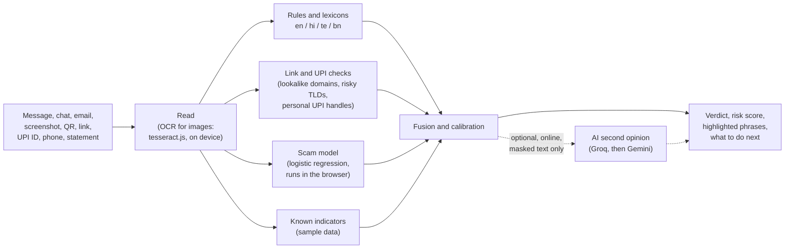

# Akshi Rakshak

**अक्षि रक्षक, "the eye that protects": a scam and fraud checker for UPI users in India.**

- Live app: *TODO (Phase 6): production URL once the Vercel project is deployed*
- Demo video: *TODO (Phase 6)*

## What it does

Paste a message, chat, email or screenshot, or check a UPI collect request, QR code, link, UPI ID, phone number or bank statement. In about a second, Akshi Rakshak gives a verdict, a 0–100 risk score, the exact phrases that gave a scam away, what the sender claims to be against what it really is, and what to do next. Text checks run on your phone, also offline, in English, Hindi, Telugu and Bengali.

## Screenshots

*TODO (Phase 6): landing, analysis, collect-request explainer, Elder STOP screen and Proof page, in `docs/screenshots/`.*

## How it works



Everything on the solid path runs in the browser. The dashed path is optional: it needs the network, sends text only after phone numbers, account numbers and similar details are masked, and the app works without it.

## The AI and ML

- **Rules and lexicons** (`packages/engine`): scam signals such as "enter your PIN to receive", OTP requests, threats of arrest or blocking, secrecy, screen-sharing apps and too-good returns, in four languages, each with the phrase it matched.
- **Scam model** (`packages/model`, trained in `ml/`): TF-IDF over word 1–2-grams and character 2–5-grams with logistic regression (scikit-learn), exported to JSON (about 133 KB gzipped) and run in TypeScript with the same results as Python (checked on 200 texts). A second, sparse model suggests the scam category.
- **Link and UPI checks**: lookalike and punycode domains, risky TLDs, shortened links, brand names on personal UPI handles, prefilled amounts in QR codes. Online extras (expanding a short link, domain age) are optional.
- **OCR**: tesseract.js with English, Hindi, Telugu and Bengali trained data, on the device.
- **Statement anomaly detection** (`packages/insights`): a bank-statement CSV is parsed on the device; rules (credit followed by a return payment, bursts, large or round payments to a new payee, odd hours, duplicates, velocity) and an Isolation Forest implemented in TypeScript flag unusual payments.
- **LLM second opinion** (optional): Groq first, Google Gemini as fallback, through the Vercel AI SDK, with a JSON schema for the answer. Its reply is checked on the server and again in the app. Its score is blended in at a fixed 20% share and can raise the local score by at most 15 points.

### Measured results

From `npm run eval` on the held-out **test split of our synthetic dataset** (527 messages, full system without the AI second opinion; a message counts as flagged when the verdict is "scam" or "suspicious"). Engine 0.3.0, model 2026.11.18-a:

| | Precision | Recall | F1 | False alarms |
|---|---:|---:|---:|---:|
| Rules only | 95.3% | 49.8% | 65.4% | 2.1% |
| Rules + model | 96.4% | 85.4% | 90.6% | 2.9% |
| Full system, no AI | 96.7% | 94.7% | 95.7% | 2.9% |

By language, F1 is 96.5% for English, 95.2% for Hindi, 92.0% for Telugu and 100% for Bengali. On genuine bank, OTP and UPI messages, 4.3% (6 of 140) are wrongly marked "suspicious"; no genuine message got the "scam" verdict. Weak spots: romance scams (3 of 9 caught) and phishing links (10 of 15). The training data is synthetic, so expect lower numbers on real messages. A team-written test set and a sample run with the AI second opinion are added before submission (TODO). Every number, by language and by scam type, is on the app's **Proof** page (`/proof`), and how they were produced is in `docs/eval-notes.md`.

## Privacy and offline use

- Text, images and statements are checked **on your device**. Nothing is uploaded for a normal check.
- The AI second opinion is optional and receives **masked** text only. Screenshot transcription by a cloud model is opt-in and asks first.
- After one visit, the app works in **airplane mode** (installable PWA).
- No accounts and no analytics scripts. Community reports send only the reported value (a UPI ID, number or link).

## Languages

English, Hindi (Devanagari and romanised Hinglish), Telugu and Bengali for checks, explanations and content. Hindi, Telugu and Bengali text was drafted with AI help and is being reviewed by native readers (`docs/i18n-review.md`).

## Run locally

Needs Node.js 22 or later.

```bash
npm install
npm run dev          # web app + local API (http://localhost:3001/api)
```

Other commands: `npm test`, `npm run typecheck`, `npm run lint`, `npm run eval` (writes the Proof page report), `npm run dev:api` (API only).

**Text checks need no keys and work offline.** The optional online features read these environment variables. Copy `.env.example` to `.env` (never commit `.env`):

| Variable | Needed for | Notes |
|---|---|---|
| `GROQ_API_KEY` | AI second opinion, Ask Akshi rewrite | Free-tier key from console.groq.com |
| `GROQ_MODEL` | same | A Groq model with JSON Schema structured output, e.g. `openai/gpt-oss-20b` |
| `GEMINI_API_KEY` | fallback AI provider; screenshot transcription | Free-tier key from Google AI Studio |
| `GEMINI_MODEL` | fallback AI provider | A Flash or Flash-Lite model, e.g. `gemini-3.1-flash-lite` |
| `GEMINI_VISION_MODEL` | screenshot transcription (opt-in) | An image-capable model; can be the same as `GEMINI_MODEL` |
| `KV_REST_API_URL` + `KV_REST_API_TOKEN` | community report counts (optional) | Or `UPSTASH_REDIS_REST_URL` + `UPSTASH_REDIS_REST_TOKEN` (used first if both pairs are set). Injected by Vercel's Upstash integration. Without them `/api/reports` answers 503 and the app works without counts |
| `PORT` | local API server (optional) | Default `3001` |

A provider is used only when both its key and its model are set. `/api/health` shows which providers are configured, never the values.

### Retraining the model (optional)

```bash
cd ml
python3.11 -m venv .venv && .venv/bin/pip install -r requirements.txt
.venv/bin/python -m akshi_ml.build_dataset   # data/messages/messages.jsonl
.venv/bin/python -m akshi_ml.train           # packages/model/model/scam-model.json
.venv/bin/python -m akshi_ml.parity          # fixtures for the TypeScript parity test
.venv/bin/python -m pytest
```

## Deploy

Vercel (Hobby plan): import the repository, framework "Other", root directory = repository root. `vercel.json` sets the install and build commands, the output folder, the API functions and security headers. Add the environment variables above for Production and Preview, and optionally connect Upstash Redis from the Vercel Marketplace. `npm run smoke -- https://<project>.vercel.app` checks the deployed API.

## Project structure

```
apps/web/            React web app (PWA)
packages/contracts/  shared types and zod schemas
packages/engine/     analysis engine: rules, lexicons, links, UPI, OCR, fusion
packages/model/      exported scam model and TypeScript inference
packages/insights/   bank statement parser and anomaly detection
packages/content/    drills, FAQ, emergency steps, pattern cards, samples, eval report
api/                 Vercel Functions: AI second opinion, ask, link expand, domain age, reports
eval/                evaluation harness (npm run eval), error listing, calibration search
ml/                  Python: dataset generator, validator, training, parity
data/                templates, fillers, generated messages, sample statements, handwritten set
scripts/             dev API server, OCR assets, bundle size, smoke test
docs/                specs, progress logs, dataset card, evaluation notes
```

## Dataset statement

The model is trained on a **synthetic** dataset made for this project: 3,579 messages (1,739 scams in 19 categories, 1,840 genuine) in English, Hindi (41% of it romanised), Telugu and Bengali, generated from 250 hand-written template families with variations (spelling, casing, emoji, spaced-out words, Hinglish spellings). Families never cross the train, validation and test splits. About half of the genuine messages (900) are "hard negatives" that look like scams: real-style OTPs, debit alerts, UPI confirmations, delivery updates, bank offers and fraud-awareness notices. Every phone number, UPI ID, link and account number is invented; scam domains are strings that were never visited. A test set of about 150 messages written by the team is kept apart from training and tuning. Limits: synthetic text is cleaner and more regular than real messages, and the Hindi, Telugu and Bengali templates were drafted with AI help. Details: `docs/dataset-card.md`.

The indicator list and community counts in the app are **sample data**, labelled as such.

## Credits

**AI APIs:** [Groq](https://groq.com) (LLM second opinion and assistant), [Google Gemini](https://ai.google.dev) (fallback and screenshot transcription), via the [Vercel AI SDK](https://ai-sdk.dev) (`ai`, `@ai-sdk/groq`, `@ai-sdk/google`).

**OCR:** [tesseract.js](https://github.com/naptha/tesseract.js) and tesseract.js-core, with `eng`, `hin`, `tel` and `ben` trained data from [tesseract-ocr/tessdata_fast](https://github.com/tesseract-ocr/tessdata_fast).

**Engine and API:** [zod](https://zod.dev), [tldts / tldts-icann](https://github.com/remusao/tldts), [undici](https://github.com/nodejs/undici).

**Web app:** [React](https://react.dev), [React Router](https://reactrouter.com), [Vite](https://vite.dev), [vite-plugin-pwa](https://vite-pwa-org.netlify.app), vite-plugin-static-copy, [Tailwind CSS](https://tailwindcss.com) and tw-animate-css, [shadcn/ui](https://ui.shadcn.com) with [Radix UI](https://www.radix-ui.com), class-variance-authority, clsx, tailwind-merge, [cmdk](https://cmdk.paco.me), [sonner](https://sonner.emilkowal.ski), [lucide-react](https://lucide.dev), [Motion](https://motion.dev), [Lenis](https://lenis.darkroom.engineering), [react-force-graph-2d](https://github.com/vasturiano/react-force-graph), [i18next](https://www.i18next.com) and react-i18next, [zustand](https://zustand.docs.pmnd.rs), [Dexie](https://dexie.org), [jsQR](https://github.com/cozmo/jsQR), html-to-image, and [Fontsource](https://fontsource.org) fonts (Geist, Geist Mono, Noto Sans Devanagari, Noto Sans Telugu, Noto Sans Bengali).

**Machine learning (training only, not shipped):** [scikit-learn](https://scikit-learn.org), [NumPy](https://numpy.org), [SciPy](https://scipy.org), [pandas](https://pandas.pydata.org), [joblib](https://joblib.readthedocs.io), [PyYAML](https://pyyaml.org), [pytest](https://pytest.org).

**Tooling:** [TypeScript](https://www.typescriptlang.org), [Vitest](https://vitest.dev), [Playwright](https://playwright.dev) and axe-core, Testing Library, jsdom, [ESLint](https://eslint.org) and typescript-eslint, [Prettier](https://prettier.io), [tsx](https://tsx.is), concurrently.

**Content sources:** emergency steps point to the National Cyber Crime Reporting Portal (cybercrime.gov.in, helpline 1930) and Sanchar Saathi Chakshu (sancharsaathi.gov.in).

Built with help from AI coding assistants (Claude Code).

## Team

*TODO (Phase 6): team names.*

## Licence

[MIT](LICENSE)
